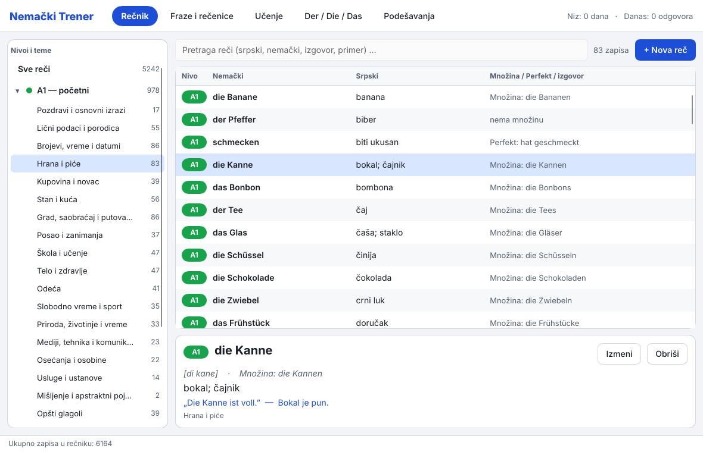
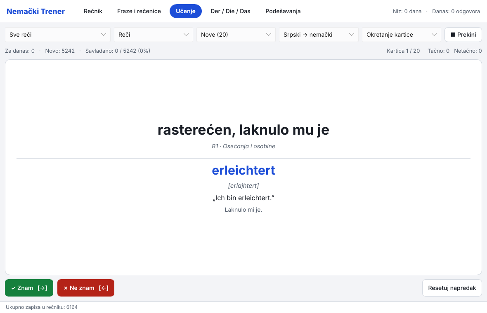
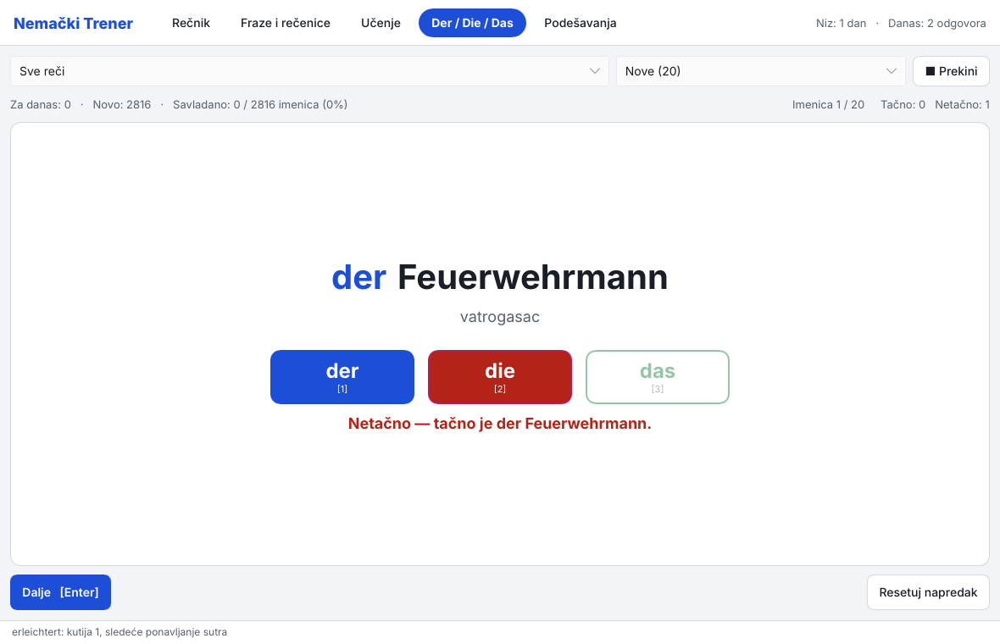

# Nemački Trener 3.0

Srpsko-nemački rečnik i vežbe po nivoima **A1 – B2**. Napisano u Rustu, interfejs je Slint.
Jedan izvršni fajl, bez Pythona — rečnik je ugrađen u program.



| Učenje | Der / Die / Das |
|---|---|
|  |  |

## Šta ima u verziji 3.0 (faza 1)

| Tab | Šta radi |
|---|---|
| **Rečnik** | Reči po nivoima i temama, pretraga (i bez kvačica: „kase” nalazi „Käse”), dodavanje, izmena, brisanje |
| **Fraze i rečenice** | Isto, za rečenice |
| **Učenje** | Kartice sa ponavljanjem po kutijama (danas, 1, 3, 7, 14, 30 dana); okretanje kartice ili kucanje odgovora |
| **Der / Die / Das** | Vežba roda imenica, sa pravilima („imenice na -ung su uvek die”) |
| **Podešavanja** | Svetla / tamna tema, gde su podaci |

Rečnik: **6.164 zapisa** — A1 1.457 · A2 1.249 · B1 1.138 · B2 1.510 · Dodatno (stručno) 810.
Svaka reč iz lista po nivoima ima primer, izgovor, množinu (imenice) ili Perfekt (glagoli).

Još nije prebačeno iz Python verzije 2.2 (faza 2): tab **Vežbe** (popuni prazninu, složi rečenicu,
množina i Perfekt), **Statistika**, **izgovor zvukom**, uvoz/izvoz u CSV/JSON.

## Prečice

| Gde | Taster |
|---|---|
| Učenje (kartice) | `Space` prikaži odgovor · `→` znam · `←` ne znam |
| Učenje (kucanje) | `Enter` proveri, pa `Enter` dalje |
| Der / Die / Das | `1` der · `2` die · `3` das (ili `D`, `I`, `A`) · `Enter` dalje |

## Gde su podaci

| Sistem | Folder |
|---|---|
| Linux | `~/.local/share/nemacki-trener/` |
| Windows | `%APPDATA%\NemackiTrener\` |

U tom folderu su:

- `nemacki_recnik.db` — rečnik i tvoj napredak (isti format kao u Python verziji);
- `liste/` — tvoje dodatne liste reči (`.txt`).

**Prenos napretka iz Python verzije (2.1 ili 2.2):** zatvori program i prekopiraj svoj stari
`nemacki_recnik.db` u gornji folder (preko postojećeg). Pri sledećem pokretanju program sam doda
nove reči; napredak ostaje. Baze starije od 2.1 prvo jednom otvori u Python verziji 2.2.

**Prenosivi režim:** ako `nemacki_recnik.db` stoji u istom folderu kao program, koristi se taj fajl
(zgodno za USB).

Provera bez prozora: `nemacki-trener --provera` ispiše koliko ima zapisa i napretka.

## Dodavanje sopstvenih reči

Najlakše: dugme **+ Nova reč** u programu.

Više reči odjednom: napravi tekst fajl u folderu `liste/`, npr. `b1_moje.txt`
(nivo se čita iz imena fajla: `a1_`, `a2_`, `b1_`, `b2_`):

```
## Posao i zanimanja
N | der Tisch | die Tische | sto | Der Tisch ist neu. | Sto je nov.
V | gehen | ist gegangen | ići | Ich gehe nach Hause. | Idem kući.
A | groß | | velik | Das Haus ist groß. | Kuća je velika.
W | heute | | danas | Heute ist Montag. | Danas je ponedeljak.
S | Wie geht's? | Kako si?
```

`N` imenica (sa članom i množinom; `—` ako nema množinu), `V` glagol (sa Perfektom), `A` pridev,
`W` ostale reči, `S` rečenica. `## Naziv teme` počinje novu temu. Izgovor se računa sam.
Nove reči se dodaju pri sledećem pokretanju; ako u fajlu ima grešaka, program ih prijavi.

## Pravljenje iz izvornog koda

Potreban je Rust (https://rustup.rs).

```
cargo run --release          # pokretanje
cargo test                   # testovi
```

### Linux (bilo koja distribucija, bez paketa)

```
cargo build --release
packaging/linux/instaliraj.sh      # instalira u ~/.local, bez sudo
packaging/linux/deinstaliraj.sh    # uklanja program (podaci ostaju)
```

### Arch Linux (paket)

```
cd packaging/arch
./napravi-paket.sh -i        # napravi paket i instaliraj ga (makepkg -si)
```

Bez `-i` samo napravi `nemacki-trener-3.0.0-1-x86_64.pkg.tar.zst`, koji se instalira sa
`sudo pacman -U ...`. Posle instalacije program je u meniju kao „Nemački Trener”.

### Windows (instalacija .exe)

1. Instaliraj Rust (https://rustup.rs) i Inno Setup 6 (`winget install JRSoftware.InnoSetup`).
2. U folderu projekta pokreni u PowerShell-u:

```
powershell -ExecutionPolicy Bypass -File packaging\windows\napravi-instalaciju.ps1
```

U folderu `dist\` dobijaš `NemackiTrener-3.0.0-setup.exe` (instalacija) i
`NemackiTrener-3.0.0-portable.zip` (samo program).

### GitHub

Ako projekat staviš na GitHub, `.github/workflows/build.yml` sam pravi Linux fajl i Windows
instalaciju kad napraviš oznaku verzije (`git tag v3.0.0 && git push --tags`).

## Struktura koda

```
src/
  main.rs        pokretanje, --provera
  ctl.rs         stanje aplikacije i veza sa interfejsom
  ui_browse.rs   Rečnik / Fraze + dijalog za unos
  ui_learn.rs    Učenje
  ui_gender.rs   Der / Die / Das
  db.rs          SQLite (ista šema kao Python verzija), dopuna rečnika
  progress.rs    kutije (spaced repetition), niz dana
  check.rs       provera odgovora, pravila za rod
  wordlists.rs   čitanje data/*.txt
  vuk.rs         izgovor „po Vuku”
  text.rs        poređenje i pretraga bez kvačica
ui/              Slint fajlovi (tema, strane, dijalozi)
data/            rečnik: a1_*.txt … b2_*.txt + legacy.tsv (starije i stručne reči)
packaging/       arch (PKGBUILD), windows (Inno Setup), linux (instaliraj.sh), ikonica, .desktop
docs/slike/      slike ekrana
```

Istorija izmena je u [CHANGELOG.md](CHANGELOG.md).

## Licenca

GPL-3.0-or-later, tekst je u fajlu [LICENSE](LICENSE). Slint se besplatno koristi pod GPLv3.
